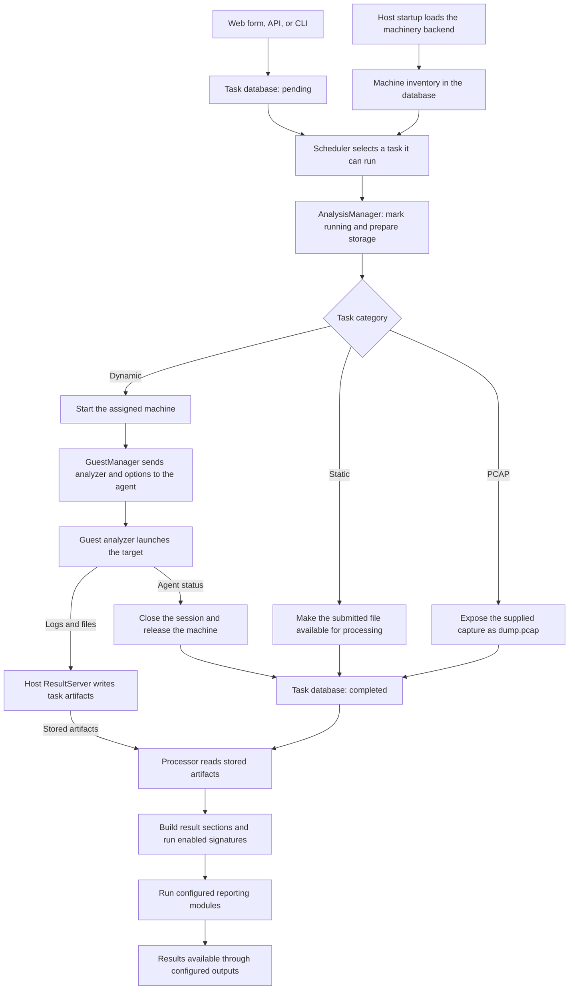

# CAPEv2 application flow

Follow one task ID through the system. The database records who is working on the task and its current state. The analysis directory holds the evidence that passes from collection to processing. The scheduler and processor can run as separate services because the task ID connects those two records. [Scheduler service](systemd/cape.service) · [Processor service](systemd/cape-processor.service)

## 1. Submit a target and create a task

The browser submission route enters `web/submission/views.py:index()`. An API file upload enters `tasks_create_file()` through `POST /apiv2/tasks/create/file/`. The API handler parses request options, calls `process_new_task_files()` to validate and stage uploaded content, then dispatches each accepted file according to its category. The API returns the resulting IDs in `data.task_ids`. [Browser submission](web/submission/views.py#L299) · [API file handler](web/apiv2/views.py#L459) · [Upload staging](lib/cuckoo/common/web_utils.py#L1789)

For an ordinary dynamic upload, the web and API handlers call `web_utils.download_file()`. That helper passes the staged path and settings such as machine, platform, package, timeout, and route into `db.demux_sample_and_add_to_db()`. The CLI stages its own temporary file in `utils/submit.py:submit_file()` and enters the same database helper. Demultiplexing can generate more than one task from a single submission. Static and PCAP branches have dedicated insertion methods, and URL submission calls `db.add_url()`. [Web submission helper](lib/cuckoo/common/web_utils.py#L812) · [CLI file submission](utils/submit.py#L33) · [Demultiplexing](lib/cuckoo/core/data/tasking.py#L525) · [Category-specific insertion](lib/cuckoo/core/data/tasking.py#L772)

The task methods converge on `add()`. It records the target and task options, associates file-based targets with sample metadata, and inserts a `Task` row. The task starts as `pending`. The task ID identifies the request throughout the pipeline, and the sample hash identifies the bytes that were submitted. [Database insertion](lib/cuckoo/core/data/tasking.py#L197) · [Task model](lib/cuckoo/core/data/task.py#L60)

For request and response details, see [Web interface and API](web/WEB_INTERFACE_AND_API.md) and [Submission and processing](utils/SUBMISSION_AND_PROCESSING.md).

## 2. Start the host, load the backend, and assign a machine

The scheduler service enters `cuckoo.py`. `cuckoo_init()` initializes the database, logging, and plugins, then sets up the rooter and routing and creates the ResultServer. `cuckoo_main()` creates a `Scheduler` and calls `start()`. The scheduler initializes the machinery when a manager is configured and then runs the scheduling loop. [Host initialization](cuckoo.py#L53) · [Host entry point](cuckoo.py#L98) · [Scheduler startup](lib/cuckoo/core/scheduler.py#L363)

### Startup and machine registration

1. **Read the backend name.** The local configuration sets `machinery = qemu_external` in the `[cuckoo]` section. During startup, `init_modules()` calls `import_plugin(f"modules.machinery.{cuckoo.cuckoo.machinery}")`. This resolves to `modules.machinery.qemu_external`, which defines the `QEMUExternal` class. [Local configuration](custom/conf/cuckoo.conf#L2) · [Plugin import](lib/cuckoo/core/startup.py#L544) · [Backend implementation](modules/machinery/qemu_external.py#L133)
2. **Instantiate the backend.** `MachineryManager.__init__()` reads the same setting into `self.machinery_name`. Its `create_machinery()` method instantiates the registered machinery plugin, and the constructor checks that the instance's `module_name` matches the configured name. [Constructor](lib/cuckoo/core/machinery_manager.py#L147) · [Plugin instantiation](lib/cuckoo/core/machinery_manager.py#L202)
3. **Populate the machine inventory.** `Machinery.initialize()` clears the existing machine inventory and calls `_initialize()`. For this backend, the latter reads `machines = cape_arm64` from `[qemu_external]`, looks up `[cape_arm64]`, and calls `self.db.add_machine(...)` to populate the `machines` table. This entry has label `cape-arm64`, platform `linux`, architecture `arm64`, and tags `arm` and `arm64`. [Backend configuration](conf/qemu_external.conf#L1) · [Inventory initialization](lib/cuckoo/common/abstracts.py#L138) · [Machine model](lib/cuckoo/core/data/machines.py#L50)

### Task matching and assignment

1. **Find a candidate.** `Scheduler.find_pending_task_to_service()` examines pending tasks in descending priority and then arrival order. For tasks that require a machine, it calls `MachineryManager.find_machine_to_service_task()`. The manager delegates to the backend, and the default machinery implementation used by `qemu_external` delegates to the database. [Scheduler](lib/cuckoo/core/scheduler.py#L214) · [Manager](lib/cuckoo/core/machinery_manager.py#L210) · [Default machinery lookup](lib/cuckoo/common/abstracts.py#L275)
2. **Match against the database.** The lookup starts with `select(Machine)` and applies the task's explicit machine label, platform, architecture, tags, and any OS requirement derived from the package. If the task specifies a machine, the condition is `Machine.label == task.machine`. For the example above, that value is `cape-arm64`. The name `cape_arm64` identifies the configuration section. [Database lookup and filters](lib/cuckoo/core/data/machines.py#L214)
3. **Assign or wait.** If the lookup returns an unlocked machine, `AnalysisManager.prepare_task_and_machine_to_start()` sets the task to `running`, records the assignment, locks the machine, and creates a guest record. If compatible machines exist but are all locked, the lookup returns `None` and the task remains pending. If the filters match no machine, the lookup raises `CuckooUnserviceableTaskError`. The scheduler uses `fail_unserviceable` to decide whether to mark that task as `failed_analysis` or leave it pending. [Assignment](lib/cuckoo/core/analysis_manager.py#L149) · [Scheduler error handling](lib/cuckoo/core/scheduler.py#L235)

The selection and `prepare_task_and_machine_to_start()` run in the scheduler's database transaction. After that block, `Scheduler.do_main_loop_work()` calls `analysis_manager.start()`. Since `AnalysisManager` subclasses `threading.Thread`, this calls Python's inherited `Thread.start()`. Python starts a new thread and invokes CAPE's `AnalysisManager.run()` in that thread. The code path continues through `run() → launch_analysis() → perform_analysis()`. Tasks that need no machine, such as `static` and `pcap`, also enter through this thread. [Call to start()](lib/cuckoo/core/scheduler.py#L185) · [Thread subclass](lib/cuckoo/core/analysis_manager.py#L101) · [run() implementation](lib/cuckoo/core/analysis_manager.py#L533)

For configuration precedence, the backend catalog, and ownership of task state, see [Configuration](conf/CONFIGURATION.md), [Machinery backends](modules/machinery/MACHINERY_BACKENDS.md), and [Host task lifecycle](lib/HOST_TASK_LIFECYCLE.md).

## 3. Prepare storage and choose the execution path

The analysis thread enters `AnalysisManager.run()`, which calls `launch_analysis()` and then `perform_analysis()`. `init_storage()` creates `storage/analyses/<id>/` and refuses to overwrite an existing directory. For `file`, `static`, and `pcap`, `category_checks()` computes the SHA-256 of the target, compares it with the registered sample hash, and calls `store_file()`. That method stores the file at `storage/binaries/<sha256>` and creates the task's `binary` symlink or copy. [Thread entry](lib/cuckoo/core/analysis_manager.py#L533) · [Storage setup](lib/cuckoo/core/analysis_manager.py#L165) · [Category checks](lib/cuckoo/core/analysis_manager.py#L283)

| Branch | What the analysis manager does next |
| --- | --- |
| Dynamic | Enters the machine, ResultServer, routing, and host auxiliary contexts, then calls `run_analysis_on_guest()`. |
| Static | Prepares the sample and the standard task directories, then returns to `launch_analysis()` for the handoff to host processing. |
| PCAP | Also exposes the supplied capture as `dump.pcap` in the task directory, where network processors expect to find it. |

For the exact branch point and the context order, see [AnalysisManager.perform_analysis()](lib/cuckoo/core/analysis_manager.py#L451). For the files produced in each branch, see [Host task lifecycle](lib/HOST_TASK_LIFECYCLE.md) and [Artifact processing](modules/processing/ARTIFACT_PROCESSING.md).

## 4. Start the machine and prepare the guest

1. **Boot the machine.** `machine_running()` calls `MachineryManager.start_machine()`, which delegates to the selected backend. In the local `qemu_external` example, `QEMUExternal.start(label)` resolves the machine by label, reads per-machine settings using its configuration name, calls the parent QEMU backend, and waits for the guest agent. The parent starts the QEMU process. [Machine context](lib/cuckoo/core/analysis_manager.py#L319) · [Manager delegation](lib/cuckoo/core/machinery_manager.py#L299) · [External QEMU startup](modules/machinery/qemu_external.py#L355) · [QEMU process startup](modules/machinery/qemu.py#L393)
2. **Prepare host-side services.** The next contexts register the task and machine with `ResultServer.add_task()`, apply the task route through `route_network()`, and call `RunAuxiliary.start()`. Routing uses the host rooter when required by the selected route. An enabled host collector such as the sniffer can produce a capture in the task directory. [Analysis contexts](lib/cuckoo/core/analysis_manager.py#L391) · [Routing implementation](lib/cuckoo/core/analysis_manager.py#L632) · [Host sniffer](modules/auxiliary/sniffer.py#L38)
3. **Build guest options and upload files.** `build_options()` combines the task, machine-specific options, auxiliary settings, timeout, and ResultServer address. For a file task it also supplies the filename, detected file type, and available PE exports. `GuestManager.start_analysis()` waits for the agent, reads its features and environment, uploads the platform-specific analyzer with `POST /extract`, and uses `POST /store` for `analysis.conf` and the sample. A URL task carries its target in the task configuration. [Option construction](lib/cuckoo/core/analysis_manager.py#L247) · [Analyzer archive and configuration](lib/cuckoo/core/guest.py#L218) · [Upload sequence](lib/cuckoo/core/guest.py#L267)
4. **Launch the analyzer.** GuestManager uses `POST /execpy` if the agent advertises it and falls back to `POST /execute` otherwise. These requests start the uploaded `analyzer.py`. After launch, the host polls `GET /status` while waiting for completion. [Agent execution handlers](agent/agent.py#L658) · [Host completion polling](lib/cuckoo/core/guest.py#L392)

For endpoint inputs and outputs, see [Guest agent](agent/GUEST_AGENT.md). For collectors and their outputs, see [Host auxiliaries](modules/auxiliary/HOST_AUXILIARIES.md).

## 5. Execute the target and collect evidence

Inside the guest, the analyzer loads `analysis.conf`, resolves the target, and selects a package using the requested package or the available file metadata. It starts the configured guest auxiliaries and calls the package's `start()` hook. On Linux, many packages implement `prepare()` and inherit the launch code from `lib/core/packages.py`. The Bash package, for example, passes the submitted script to Bash. Windows packages implement `start(target)` and can return process IDs for the analyzer to monitor. The analyzer runs its monitoring loop, finishes the package and auxiliaries, and sends a status update to the local agent. [Linux analyzer](analyzer/linux/analyzer.py#L210) · [Linux package base](analyzer/linux/lib/core/packages.py#L114) · [Bash package](analyzer/linux/modules/packages/bash.py) · [Windows package selection](analyzer/windows/analyzer.py#L429) · [Windows analyzer](analyzer/windows/analyzer.py#L480)

The guest sends evidence directly to the **host ResultServer** while the host polls the **guest agent** for status. For example, the guest's `upload_to_host()` opens a `FILE` stream with an analysis-relative destination. ResultServer associates the incoming connection with the registered task and dispatches `FILE`, `LOG`, `BSON`, or `PROTO` to the corresponding handler. `FileUpload` writes the artifact into the task directory and can append a metadata record to `files.json`. `LogHandler` writes `analysis.log`, and the binary handlers write process logs under `logs/`. [Guest upload helper](analyzer/linux/lib/common/results.py#L19) · [ResultServer dispatch table](lib/cuckoo/core/resultserver.py#L718) · [File upload handler](lib/cuckoo/core/resultserver.py#L293) · [Connection handling](lib/cuckoo/core/resultserver.py#L774)

For package selection, platform differences, and guest-side collectors, see [Guest analyzers](analyzer/GUEST_ANALYZERS.md), [Linux auxiliaries](analyzer/linux/modules/auxiliary/LINUX_AUXILIARIES.md), and [Windows auxiliaries](analyzer/windows/modules/auxiliary/WINDOWS_AUXILIARIES.md). For the receive side, see [Host task lifecycle](lib/HOST_TASK_LIFECYCLE.md).

## 6. Close the session and hand off to the processor

`run_analysis_on_guest()` follows guest execution through its separate guest record. When the dynamic analysis exits, the contexts stop host auxiliaries, remove task routing, and unregister the ResultServer task. The machine context can take a memory dump before stopping and releasing the machine. [Guest lifecycle](lib/cuckoo/core/analysis_manager.py#L428) · [Cleanup contexts](lib/cuckoo/core/analysis_manager.py#L391) · [Machine shutdown](lib/cuckoo/core/analysis_manager.py#L319)

| Outcome in `launch_analysis()` | Task state |
| --- | --- |
| `perform_analysis()` returns normally, including when it returns false | `completed`. The log records the outcome, so check artifacts before assuming the guest collected everything. |
| `CuckooDeadMachine` is raised | `pending` so the scheduler can attempt reassignment. |
| An unexpected exception escapes the analysis | `failed_analysis`. |

The normal handoff consists of the `completed` database row and files under `storage/analyses/<id>/`. The separate processor queries this state and opens that directory using the same task ID. This also applies to static and PCAP tasks. [State transitions](lib/cuckoo/core/analysis_manager.py#L487) · [Processor task source](lib/cuckoo/core/processing_engine/source.py#L11)

For more on status and processor operation, see [Host task lifecycle](lib/HOST_TASK_LIFECYCLE.md) and [Submission and processing](utils/SUBMISSION_AND_PROCESSING.md).

## 7. Turn artifacts into findings and publish the report

1. **Pick up the task.** `utils/process.py:autoprocess()` constructs a `TaskSource` and a configured worker engine. The source normally fetches `completed` rows in completion order, excluding IDs already in flight in the engine. `run_task()` checks the task directory and calls `process(..., report=True, auto=True)`. If the directory is missing, it sets `failed_processing`. [Processor setup](utils/process.py#L417) · [Worker engine selection](lib/cuckoo/core/processing_engine/__init__.py#L4) · [Task source](lib/cuckoo/core/processing_engine/source.py#L16) · [Worker entry](utils/process.py#L194)
2. **Build results.** `process()` creates a shared results dictionary. `RunProcessing` walks the registered modules in order, applies configuration and platform checks, and supplies each module with the task, analysis directory, and options. It merges the data returned by `run()` under that module's `key`. For example, `CAPE.run()` uses metadata from `files.json` and files in the analysis tree to build results such as `CAPE.payloads` and `CAPE.configs`. [Pipeline entry](utils/process.py#L102) · [Processing runner](lib/cuckoo/core/plugins.py#L276) · [CAPE processor](modules/processing/CAPE.py#L432)
3. **Evaluate signatures.** `RunSignatures` can send individual behavior calls to evented signatures and run other signatures over assembled results. It records the matches and derives results such as the malware score and technique mappings. The `minproc` task option restricts the processing module set and skips signature evaluation. [Minimal processing selection](lib/cuckoo/core/plugins.py#L338) · [Signature runner](lib/cuckoo/core/plugins.py#L629) · [Pipeline options](utils/process.py#L141)
4. **Publish.** `RunReporting` runs configured reporters in order and returns a count of reporting errors. The JSON reporter serializes the results to `reports/report.json`. MongoDB and Elasticsearch reporters use shared helpers to build a report document and can store behavior calls in separate chunks. When reporting completes, `process()` sets `reported` if the error count is zero or `failed_reporting` otherwise. [Reporting runner](lib/cuckoo/core/plugins.py#L900) · [JSON output](modules/reporting/jsondump.py#L47) · [Database report helpers](modules/reporting/report_doc.py#L62) · [Status update](utils/process.py#L160)

For plugin interfaces and the role of each module, see [Host plugins](modules/HOST_PLUGINS.md), [Artifact processing](modules/processing/ARTIFACT_PROCESSING.md), [Behavioral signatures](modules/signatures/BEHAVIORAL_SIGNATURES.md), and [Reporting modules](modules/reporting/REPORTING_MODULES.md).

## 8. Read the outcome through the web interface or API

| Request | Code path |
| --- | --- |
| Browser analysis page at `/analysis/<id>/` | Django routes the request to `analysis.views.report()`. The view looks up the processed analysis in the configured MongoDB or Elasticsearch backend and builds the template context. [Browser route](web/analysis/urls.py#L12) · [Browser report view](web/analysis/views.py#L2853) |
| Task status at `/apiv2/tasks/status/<id>/` | `tasks_status()` gets the operational task row and returns its current state in `data` for a successful GET. [Status handler](web/apiv2/views.py#L1561) |
| Report download at `/apiv2/tasks/get/report/<id>/` | `tasks_report()` checks access and task state, resolves the requested format to a filename, and serves the generated output. The default format is JSON, which uses `storage/analyses/<id>/reports/report.json`. [Download route](web/apiv2/urls.py#L42) · [Download handler](web/apiv2/views.py#L1604) · [Report file lookup](web/apiv2/views.py#L1706) |

In deployments using central mode, the reporting path can ship artifacts through `CentralStore`, and the web layer can stage stored artifacts before serving a download. The browser page and report download still enter through their respective handlers above. [Central reporter](modules/reporting/centralstore.py) · [Web staging helpers](web/analysis/central_views.py) · [API staging helper](web/apiv2/views.py#L2214)

For API routes and the relationship between the page, report data, and captured artifacts, see [Web interface and API](web/WEB_INTERFACE_AND_API.md).

## Follow one artifact through the code

For a Linux task with Tracee enabled, start with `Docker.collect_logs()` in the guest auxiliary. It calls `upload_to_host(..., "logs/tracee.log")`. On the host, the `FILE` handler saves that file under `storage/analyses/<id>/`. After `completed`, `TraceeAnalysis.run()` reads the log, parses event records, and returns structured data with `key = "tracee"`. `RunProcessing` merges it into the report data that the configured reporter receives. [Guest collector](analyzer/linux/modules/auxiliary/tracee.py#L151) · [File receiver](lib/cuckoo/core/resultserver.py#L336) · [Tracee processor](modules/processing/tracee.py#L91) · [Result merge](lib/cuckoo/core/plugins.py#L338)

If the log is missing, follow guest collection and the file upload. If the log is present and the result is empty, check the parser and the processing configuration. If the result is present in the generated JSON but missing from the web page, follow the configured reporting backend and browser view. [Linux collectors](analyzer/linux/modules/auxiliary/LINUX_AUXILIARIES.md) · [Processing modules](modules/processing/ARTIFACT_PROCESSING.md) · [Web interface and API](web/WEB_INTERFACE_AND_API.md)
